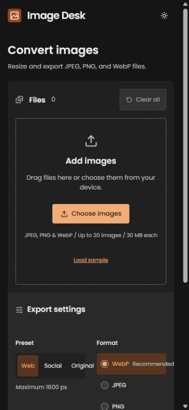

<h1>
  <picture>
    <source media="(prefers-color-scheme: dark)" srcset="docs/logo-dark.svg">
    
  </picture>
</h1>

Resize and convert images directly in the browser. Choose a format, set dimensions and quality, then download the results.

[Open Image Desk](https://jpndmatos.github.io/image-desk/)

<picture>
  <source media="(prefers-color-scheme: dark)" srcset="docs/dark.jpg">
  
</picture>

<details>
  <summary>Mobile view</summary>
  <br>
  
</details>

## Features

- Drag-and-drop uploads for JPEG, PNG, and WebP.
- Batch resizing with aspect ratios preserved.
- Format, quality, and transparency background settings.
- Original and processed previews with file-size comparisons.
- Individual downloads or a ZIP, with light and dark themes.

Images are processed on your device using Canvas. Files stay in the browser.

## Stack

React, TypeScript, Vite, Canvas API, and fflate.

## Run locally

Requires Node.js 22.14 or later.

```sh
npm ci
npm run dev
```

Open [localhost:5175](http://localhost:5175).

```sh
npm test
npm run build
npm run preview
```
