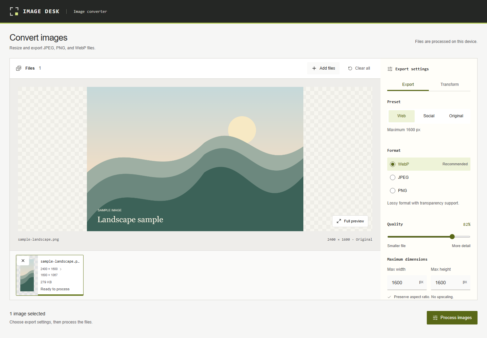

# Image Desk

Drop or paste images to resize, rotate, flip, and convert them to WebP, JPEG, or PNG. Download files individually or as a ZIP, with an optional filename prefix.



## Setup

Node.js 22.14+.

```sh
npm ci
npm run dev
```

Open http://localhost:5175. Use **Load sample** or bring your own images. Processing stays on your device; originals are untouched.
