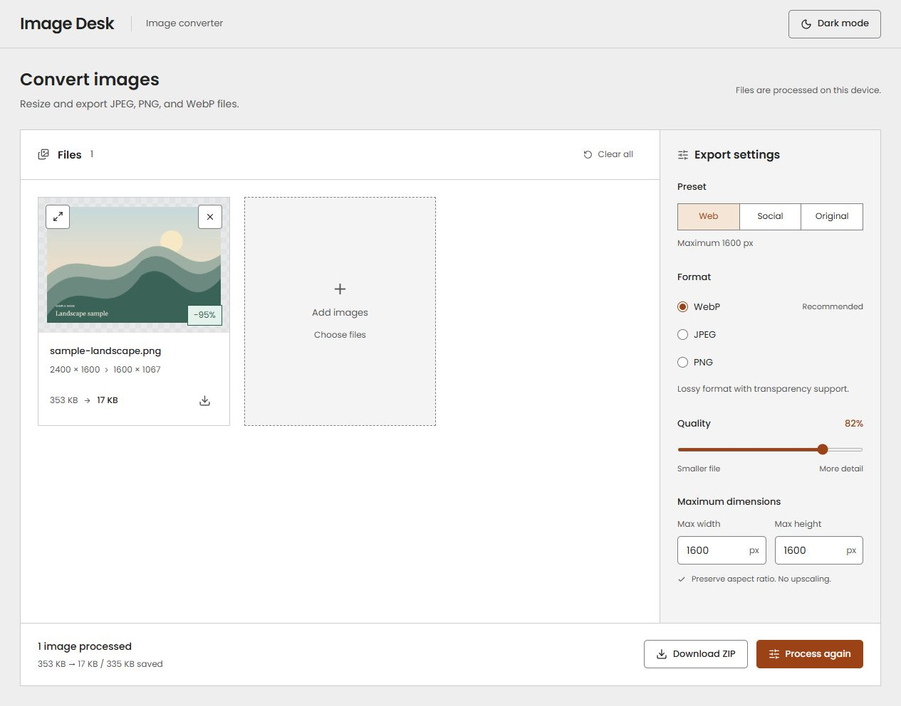
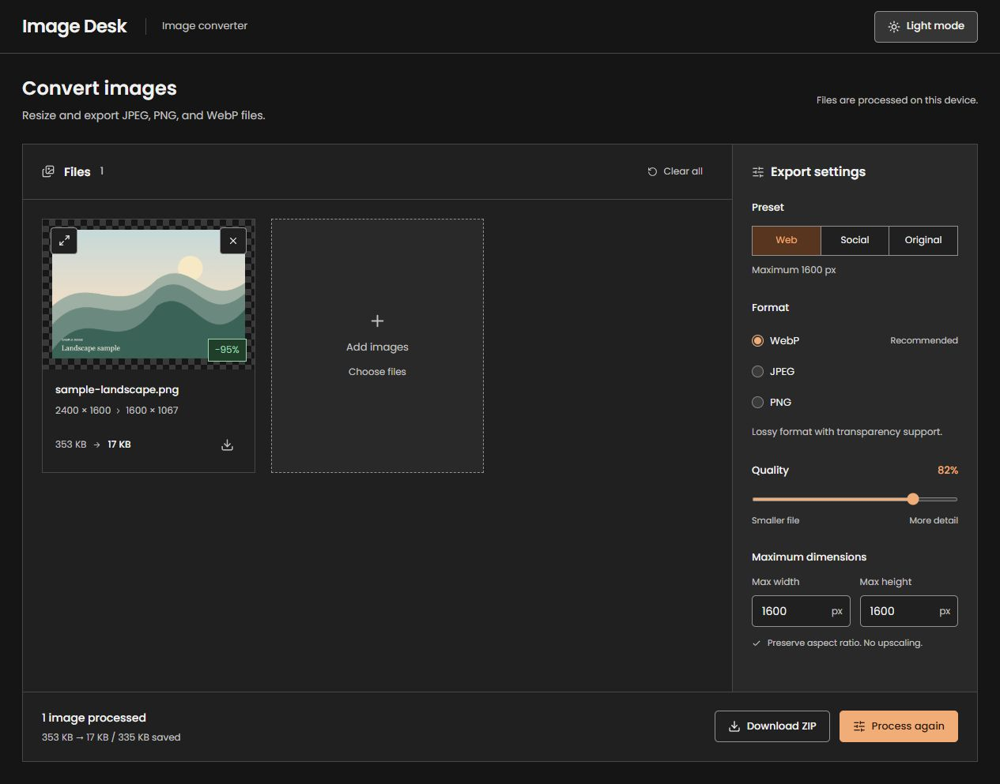

# Image Desk

Batch image resizing and format conversion, processed locally in the browser.

[Try the live demo](https://jpndmatos.github.io/image-desk/)





## What it does

- Add JPEG, PNG, and WebP images through a file picker or drag and drop.
- Process up to 20 images per batch, limited to 30 MB / 40 megapixels each.
- Export WebP, JPEG, or PNG; choose quality for lossy formats.
- Resize within maximum dimensions, preserve proportions, and avoid upscaling.
- Set a background for transparent images exported to JPEG.
- Compare original and processed previews, see actual file sizes, download one image or a ZIP.
- Try an original, procedurally drawn sample without finding a file first.

## Run locally

Node.js 22.14+ and npm (Node 24 recommended).

```sh
npm ci
npm run dev
```

Open **http://127.0.0.1:5175**.

```sh
npm test           # sizing, aspect ratios, filenames, size formatting
npm run build     # type-check and build to dist/
npm run preview   # preview the production build
```

The production app is static. `base: './'` supports hosting under a repository path, including GitHub Pages. The Pages workflow tests and builds before deploying.

## Under the desk

React, TypeScript, and Vite. Native Canvas handles resizing and encoding; fflate packages exports into a ZIP. Images are processed sequentially to reduce peak memory. Object URLs are released when images are removed, settings change, or the workspace unmounts. Filenames follow the actual encoded MIME type if a browser falls back to another format.

## Honest limits

- PNG output is lossless; its quality slider is disabled because Canvas does not use it.
- A conversion can increase file size. The UI reports that result instead of calling it a saving.
- Animated images, SVG, HEIC, and AVIF are outside this version's scope.
- Canvas exports do not preserve original EXIF metadata. This is a web preparation tool, not a print or archival editor.
- Files and settings are not saved between visits. Processing runs on the main thread, with a yield between images; very large images may briefly affect responsiveness.

Image contents never leave the browser. Code, Poppins fonts, and styles are served from the app itself. There is no analytics or account system. Light and dark themes remember the selected appearance.

Built by [João Matos](https://github.com/jpndmatos). MIT licensed. Icons by Lucide.
