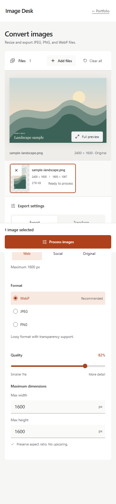

# Image Desk

A browser tool for resizing and converting images in batches. Set the size, format and quality, then download the files individually or as a ZIP.

[Open Image Desk](https://jpndmatos.github.io/image-desk/)


<details>
  <summary>Mobile view</summary>
  <br>
  
</details>

## Features

- Drag-and-drop uploads for JPEG, PNG, and WebP.
- Batch resizing, quarter-turn rotation, and horizontal flipping.
- Format, quality, and transparency background settings.
- Original and processed previews with file-size comparisons.
- Filename prefixes, individual downloads or a ZIP.

Images are processed on your device using Canvas. Files stay in the browser.

## Stack

React, TypeScript, Vite, Canvas API, and fflate.

## Run locally

Requires Node.js 22.14 or later.

```sh
npm ci
npm run dev
```

Open [localhost:5175](http://localhost:5175).

```sh
npm test
npm run build
npm run preview
```

## Implementation notes

The original files stay untouched. Changing export settings clears the previous results so an old download cannot be mistaken for a new conversion. Object URLs are revoked when a file is removed; ZIP support loads only when requested.

## Verification

The production build and unit tests pass. Portfolio integration checks cover the main workflows at 390px and 1440px, WCAG A/AA checks including WCAG 2.2 target sizes, and failure handling. The mobile Lighthouse lab result is saved in `docs/performance.json`; it is a local observation, not a field-performance guarantee.
